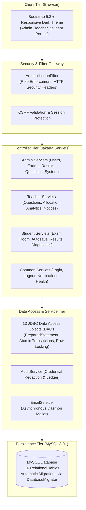

# ExamPro — Enterprise Online Examination Management Platform

[](https://www.oracle.com/java/)
[](https://jakarta.ee/)
[](https://tomcat.apache.org/)
[](https://www.mysql.com/)
[](https://maven.apache.org/)
[](https://getbootstrap.com/)
[](LICENSE)

> A secure, role-based, full-lifecycle Online Examination Management Platform engineered with **pure Java**, **Jakarta Servlets 6.0**, **JSP 3.1**, **JDBC**, and **MySQL**, designed for deployment on **Apache Tomcat 10.1**.

---

## 📌 Table of Contents

1. [Project Overview](#-project-overview)
2. [Key Features](#-key-features)
   - [Administrator Portal](#1-administrator-portal)
   - [Teacher / Faculty Panel](#2-teacher--faculty-panel)
   - [Student Examination Engine](#3-student-examination-engine)
   - [Notification & Communication Hub](#4-notification--communication-hub)
3. [Security Architecture](#-security-architecture)
4. [Technology Stack](#-technology-stack)
5. [Application Architecture](#-application-architecture)
6. [Project Structure](#-project-structure)
7. [Database Setup & Automated Migrations](#-database-setup--automated-migrations)
8. [Configuration Guide](#-configuration-guide)
9. [Prerequisites](#-prerequisites)
10. [Build & Installation](#-build--installation)
11. [Tomcat Deployment](#-tomcat-deployment)
12. [Application Access & Endpoints](#-application-access--endpoints)
13. [Screenshots](#-screenshots)
14. [Future Enhancements](#-future-enhancements)
15. [Author & Links](#-author--links)

---

## 🌟 Project Overview

**ExamPro** is an enterprise-grade examination platform architected to manage the full assessment lifecycle within educational institutions and universities. It replaces paper-based workflows with a unified, digital ecosystem catering to three core stakeholders: **System Administrators**, **Faculty Members**, and **Student Candidates**.

Unlike modern framework-heavy applications, ExamPro is built intentionally with **vanilla Jakarta EE 10 standards (Servlets 6.0, JSP 3.1) and raw JDBC**. This architectural choice demonstrates a mastery of low-level Java web fundamentals, connection pooling, transactional boundaries, session security, and clean MVC separation with zero dependency on Spring Boot or Hibernate.

### Why Apache Tomcat 10.1?
Tomcat 10.1 implements **Jakarta EE 10**, transitioning fully to the `jakarta.*` package namespace (deprecating legacy `javax.*` packages). All controllers, filters, and listeners in ExamPro strictly adhere to the modern Jakarta namespace.

---

## 🚀 Key Features

### 1. Administrator Portal
- **Executive Dashboard:** Real-time database telemetry tracking active student bodies, faculty counts, curriculum courses, ongoing tests, total submission attempts, and institutional pass rates.
- **Unified User Directory:** Central management console across all roles (Admin, Teacher, Student) with keyword search, active status toggling, self-deactivation protection, and last-active-admin lockout guards.
- **Student Candidate Management:** Registration tracking, enrolment verification, department filtering, and academic profile oversight.
- **Faculty Management:** Departmental assignments, faculty ID assignment, workload distribution, and teaching authorizations.
- **Curriculum & Subject Catalog:** Academic course administration with course code validation, credit configurations, and active status controls.
- **Examination Lifecycle Management:** Complete state transitions (`DRAFT` $\rightarrow$ `SCHEDULED` $\rightarrow$ `ONGOING` $\rightarrow$ `COMPLETED` $\rightarrow$ `CANCELLED`), time limit configuration, passing mark boundaries, and candidate rosters.
- **Central Question Bank Oversight:** Cross-curriculum question inspection filtered by subject, authoring faculty, difficulty (`EASY`, `MEDIUM`, `HARD`), topic name, and keyword search. Features safe relational deletion guards preventing accidental deletion of questions linked to exams.
- **Result Moderation & Analytics:** Institutional scorecards, pass/fail and score distribution charts (Chart.js), on-demand result publication gates, and auditable marks adjustments with transaction-locked change tracking (`result_audit_logs`).
- **Institutional Report Generation:** Role-scoped Excel-compatible CSV exports (with UTF-8 BOM encoding) and printable official grade sheets with signature blocks.
- **Institutional Announcements:** Campus-wide notice board with priority levels (`NORMAL`, `IMPORTANT`, `URGENT`), target role scoping (`ALL`, `STUDENT`, `TEACHER`), scheduling windows, and automated in-app broadcasts.
- **Central Security Audit Ledger:** Searchable, immutable event ledger recording logins, administrative updates, and exam events with client IP extraction and automated credential scrubbing.
- **System Telemetry & Health:** Real-time JVM memory heap metrics (Used, Free, Max, Heap %), host CPU specifications, container context, and MySQL connection health diagnostics.

### 2. Teacher / Faculty Panel
- **Faculty Dashboard:** Personalized workspace showing assigned curriculum subjects, authored questions, upcoming test schedules, and candidate evaluation metrics.
- **Question Bank & MCQ Authoring:** Interactive authoring tool supporting 4-option multiple-choice questions, difficulty indicators, subject alignment, topic tagging, point values, and explanation keys.
- **Assigned Examinations Monitor:** Oversight of examinations scheduled under the teacher's authorized subjects.
- **Exam Question Allocation:** Examination question allocator enabling faculty to attach questions from their bank, customize per-question marks, and enforce total mark requirements.
- **Result Analytics & Item Difficulty Analysis:** Psychometric evaluation engine computing per-question accuracy rates, attempt counts, and difficulty rating indicators to identify problematic questions.
- **Departmental Reports:** Course-scoped CSV export and printable grade rosters with item analysis breakdowns.
- **Course Announcements:** Subject-specific announcement authoring with enrolled student broadcast dispatch; strictly protected against cross-teacher tampering.
- **Faculty Profile Management:** Profile editing and secure self-service password updates with BCrypt validation.

### 3. Student Examination Engine
- **Candidate Dashboard:** Overview displaying active tests, upcoming exam alerts, total completed attempts, average performance percentage, and recent scorecards.
- **Available Examinations Catalog:** Real-time filter showing published examinations currently open within their active test windows.
- **Pre-Exam Instructions Room:** Checklist displaying duration, question count, scoring criteria, passing marks, and honor code rules prior to attempt initiation.
- **Online Examination Room:**
  - **Server-Synchronized Countdown Timer:** Anti-tampering timer calculated from server timestamps (`max_end_time`) to prevent client-side clock tampering.
  - **Question Navigation Palette:** Interactive status grid tracking *Answered*, *Unanswered*, and *Marked for Review* questions.
  - **Asynchronous Background Autosave:** Debounced AJAX synchronization preserving student choices across network disconnects.
  - **Zero Answer-Key Leakage:** Sanitized question models (`ExamTakeQuestion`) that exclude correct answer flags from HTTP responses.
- **Automatic Instant Evaluation:** Real-time scoring upon candidate submission or automatic timeout, evaluating answers, calculating percentages, and recording scorecard entries atomically.
- **Performance Diagnostics & Analytics:** Diagnostic dashboard tracking score progression over time, subject proficiency breakdowns, identified strong topics ($\ge 70\%$), and weak areas needing remediation ($< 50\%$).
- **Publication Privacy Protection:** Unreleased exam scorecards display an informative "Pending Publication" banner and withhold answer breakdowns until published by administration.
- **Candidate Transcript Printing:** Official formatted printable result sheets.

### 4. Notification & Communication Hub
- **In-App Notification Center:** Database-backed notification center featuring live unread badge counters, category icons, priority tags, mark-read actions, individual dismissals, and bulk clear operations.
- **Topbar Bell Component:** Reusable notification dropdown embedded across all portal headers with background AJAX polling.
- **Asynchronous Resilient Email Service:** Background daemon thread pool email dispatch via Jakarta Mail 2.1 with graceful non-blocking fallback when SMTP is unconfigured.

---

## 🔒 Security Architecture

ExamPro implements enterprise security standards across all layers:

| Security Domain | Implementation Details |
| :--- | :--- |
| **Password Security** | One-way salted hashing using **BCrypt** (`at.favre.lib:bcrypt`, Cost Factor: 12). Passwords are never stored or logged in plain text. |
| **Brute-Force Throttling** | 5 consecutive failed login attempts trigger an automated **15-minute temporary lockout** (`users.lockout_until`). Successful authentication resets the counter. |
| **Session Fixation Defense** | Calls `request.changeSessionId()` upon successful authentication to rotate session tokens and neutralize fixation attacks. |
| **Session Termination** | Complete server-side session invalidation and attribute cleansing upon logout (`/logout`). |
| **Role-Based Access Control** | Enforced by `AuthenticationFilter`: `/admin/*` requires `ROLE_ADMIN`, `/teacher/*` requires `ROLE_TEACHER`, `/student/*` requires `ROLE_STUDENT`. Direct JSP URL access is blocked by placing all views under `/WEB-INF/views/`. |
| **CSRF Defense** | Cryptographic synchronizer tokens (`CsrfUtil`) generated per session and validated on state-altering POST requests. |
| **Sensitive Data Redaction** | `AuditService` regex-scrubs passwords, session IDs, and authorization tokens, replacing sensitive values with `[REDACTED]` before MySQL storage. |
| **Immutable Audit Trail** | `AuditLogDAO` provides zero application update or delete endpoints, ensuring tamper-resistant compliance logs. |
| **HTTP Security Headers** | Injected on every response: `X-Content-Type-Options: nosniff`, `X-Frame-Options: SAMEORIGIN`, `X-XSS-Protection: 1; mode=block`, `Referrer-Policy: strict-origin-when-cross-origin`. |

---

## 💻 Technology Stack

### Backend
- **Core Platform:** Java 17+ (compiled for release 17 bytecode)
- **Web Layer:** Jakarta Servlets 6.0, Jakarta Server Pages (JSP) 3.1
- **Template Tags:** Jakarta Standard Tag Library (JSTL) 3.0
- **Database Engine:** MySQL 8.0+
- **Data Access:** Java Database Connectivity (JDBC) using raw SQL, `PreparedStatement`, and connection lifecycles
- **Security:** BCrypt Hashing (`at.favre.lib:bcrypt:0.10.2`)
- **Email Service:** Jakarta Mail 2.1 (`jakarta.mail-api:2.1.3` + `angus-mail:2.0.3`)
- **Build System:** Apache Maven 3.8+
- **Web Server:** Apache Tomcat 10.1.x

### Frontend
- **Framework:** Bootstrap 5.3 (Responsive Grid & Modals)
- **Icons:** Bootstrap Icons 1.11
- **Typography:** Google Fonts (Inter)
- **Data Visualizations:** Chart.js (Doughnut, Bar, and Line charts)
- **Design System:** Custom CSS3 Variables (`--ep-bg: #0f172a`, `--ep-card: #1e293b`, custom dark scrollbars)
- **Interactivity:** Vanilla JavaScript (ES6+), Fetch API, Asynchronous AJAX Autosave

---

## 🏛 Application Architecture

ExamPro follows a decoupled **Model-View-Controller (MVC)** architectural pattern with defense-in-depth security:



---

## 📁 Project Structure

```
ExamPro/
├── pom.xml                                   # Maven build configuration & dependencies
├── .gitignore                                # Excludes compiled classes and db.properties
├── README.md                                 # Technical documentation
│
└── src/
    └── main/
        ├── java/
        │   └── com/exampro/
        │       ├── controller/               # 27 Jakarta Servlets (Request Handlers)
        │       │   ├── AdminAnnouncementServlet.java
        │       │   ├── AdminAuditServlet.java
        │       │   ├── AdminDashboardServlet.java
        │       │   ├── AdminExamServlet.java
        │       │   ├── AdminQuestionServlet.java
        │       │   ├── AdminResultServlet.java
        │       │   ├── AdminStudentServlet.java
        │       │   ├── AdminSubjectServlet.java
        │       │   ├── AdminSystemServlet.java
        │       │   ├── AdminTeacherServlet.java
        │       │   ├── AdminUserServlet.java
        │       │   ├── HealthCheckServlet.java
        │       │   ├── LoginServlet.java
        │       │   ├── LogoutServlet.java
        │       │   ├── NotificationServlet.java
        │       │   ├── StudentDashboardServlet.java
        │       │   ├── StudentExamServlet.java
        │       │   ├── StudentExamTakeServlet.java
        │       │   ├── StudentProfileServlet.java
        │       │   ├── StudentResultServlet.java
        │       │   ├── TeacherAnnouncementServlet.java
        │       │   ├── TeacherDashboardServlet.java
        │       │   ├── TeacherExamServlet.java
        │       │   ├── TeacherProfileServlet.java
        │       │   ├── TeacherQuestionServlet.java
        │       │   └── TeacherResultServlet.java
        │       ├── dao/                      # 13 Data Access Objects (Raw JDBC Queries)
        │       │   ├── AdminDashboardDAO.java
        │       │   ├── AnnouncementDAO.java
        │       │   ├── AuditLogDAO.java
        │       │   ├── ExamAttemptDAO.java
        │       │   ├── ExaminationDAO.java
        │       │   ├── ExamQuestionDAO.java
        │       │   ├── ExamResultDAO.java
        │       │   ├── NotificationDAO.java
        │       │   ├── QuestionDAO.java
        │       │   ├── StudentDAO.java
        │       │   ├── SubjectDAO.java
        │       │   ├── TeacherDAO.java
        │       │   └── UserDAO.java
        │       ├── filter/                   # Gateway Security Filters
        │       │   └── AuthenticationFilter.java
        │       ├── model/                    # Data Transfer Objects & Domain Models
        │       │   ├── Announcement.java
        │       │   ├── AuditDashboardStats.java
        │       │   ├── AuditLog.java
        │       │   ├── Examination.java
        │       │   ├── ExamAttempt.java
        │       │   ├── ExamQuestion.java
        │       │   ├── ExamResult.java
        │       │   ├── ExamTakeQuestion.java
        │       │   ├── Notification.java
        │       │   ├── Question.java
        │       │   ├── QuestionOption.java
        │       │   ├── ResultAuditLog.java
        │       │   ├── Student.java
        │       │   ├── Subject.java
        │       │   ├── Teacher.java
        │       │   └── User.java
        │       └── util/                     # Enterprise Core Utilities
        │           ├── AdminProvisioner.java
        │           ├── AuditService.java
        │           ├── CsrfUtil.java
        │           ├── DatabaseMigrator.java
        │           ├── DBConnection.java
        │           ├── EmailService.java
        │           └── PasswordUtil.java
        │
        ├── resources/
        │   ├── db.properties                 # (Local configuration - git-ignored)
        │   ├── schema.sql                    # Initial database schema
        │   └── schema_update.sql             # Relational incremental schema
        │
        └── webapp/
            ├── index.jsp                     # Public Landing Page
            ├── login.jsp                     # Unified Sign In View
            ├── css/
            │   └── main.css                  # Modern Dark Theme Stylesheet
            ├── js/
            │   └── main.js                   # Client-side validation & utilities
            └── WEB-INF/
                ├── web.xml                   # Deployment Descriptor
                └── views/                    # Protected Views (Forbidden from direct URL)
                    ├── admin/                # Administrator JSPs
                    ├── teacher/              # Faculty JSPs
                    ├── student/              # Candidate & Exam Room JSPs
                    ├── notification/         # In-App Notification Center JSP
                    ├── common/               # Modular Navigation Partials (notif_bell.jsp)
                    └── error/                # Custom Error Handlers (403, 404, 500)
```

---

## 🗄 Database Setup & Automated Migrations

ExamPro uses a relational schema with **16 tables**, foreign key constraints, composite unique indexes, and audit logs.

### 1. Create the MySQL Database
Log in to your local or remote MySQL server and create the database:

```sql
CREATE DATABASE exampro
    CHARACTER SET utf8mb4
    COLLATE utf8mb4_unicode_ci;
```

### 2. Automated Schema Initialization
You **do not** need to execute manual SQL files. On application startup, the built-in `DatabaseMigrator` automatically checks, creates, and upgrades all required tables, constraints, and indexes:

1. `users` — Authentication credentials, roles, lockout timestamps
2. `student_profiles` — Enrolment details and candidate demographics
3. `teacher_profiles` — Faculty IDs, departments, qualifications
4. `subjects` — Academic course catalog and credits
5. `teacher_subjects` — Faculty-to-subject course mappings
6. `examinations` — Test configurations, duration, mark thresholds, and publication flags
7. `questions` — Question Bank items with difficulty and topics
8. `question_options` — Multiple-choice options (A/B/C/D)
9. `exam_questions` — Examination question allocations and marks
10. `exam_attempts` — Candidate sessions, server clocks, and attempt statuses
11. `student_answers` — Recorded answers, review flags, and evaluated scores
12. `exam_results` — Final scorecards, percentage, pass/fail status
13. `result_audit_logs` — Transactional marks modification audit history
14. `announcements` — Institutional and subject notices with role targeting
15. `notifications` — Database-backed candidate/faculty in-app alerts
16. `audit_logs` — Centralized, immutable security and compliance ledger

---

## ⚙️ Configuration Guide

ExamPro supports configuration via **properties files** or **environment variables**.

### Option A: Configuration File (Recommended for Local Development)
Create `src/main/resources/db.properties` (this file is excluded from Git):

```properties
# ── JDBC Driver ─────────────────────────────────────────────────────────────
db.driver=com.mysql.cj.jdbc.Driver

# ── JDBC URL ────────────────────────────────────────────────────────────────
# Format: jdbc:mysql://HOST:PORT/DATABASE_NAME?parameters
db.url=jdbc:mysql://localhost:3306/exampro?useSSL=false&serverTimezone=UTC&allowPublicKeyRetrieval=true&characterEncoding=UTF-8

# ── Database Credentials ───────────────────────────────────────────────────
db.username=YOUR_MYSQL_USERNAME
db.password=YOUR_MYSQL_PASSWORD

# ── Optional: SMTP Email Notification Settings ──────────────────────────────
# (In-app notifications work fully even if SMTP is left unconfigured)
mail.smtp.host=smtp.example.com
mail.smtp.port=587
mail.smtp.username=your-email@example.com
mail.smtp.password=your-email-password
mail.smtp.auth=true
mail.smtp.starttls.enable=true
mail.smtp.from=no-reply@exampro.com
```

### Option B: Environment Variables (Recommended for Production & Docker)
Set the following environment variables on your server:

| Environment Variable | Description | Example Value |
| :--- | :--- | :--- |
| `EXAMPRO_DB_URL` | JDBC connection string | `jdbc:mysql://localhost:3306/exampro?useSSL=false&serverTimezone=UTC` |
| `EXAMPRO_DB_USER` | MySQL database username | `exampro_user` |
| `EXAMPRO_DB_PASS` | MySQL database password | `YourSecurePassword` |
| `EXAMPRO_DB_DRIVER` | JDBC Driver class (optional) | `com.mysql.cj.jdbc.Driver` |
| `EXAMPRO_SMTP_HOST` | Outbound SMTP host (optional) | `smtp.mailgun.org` |
| `EXAMPRO_SMTP_PORT` | Outbound SMTP port (optional) | `587` |
| `EXAMPRO_SMTP_USER` | SMTP username (optional) | `postmaster@domain.com` |
| `EXAMPRO_SMTP_PASS` | SMTP password (optional) | `secret-smtp-password` |

---

## 📋 Prerequisites

Before building and running ExamPro, ensure you have the following installed:

- **Java Development Kit (JDK):** Version 17 or higher
- **Apache Maven:** Version 3.8 or higher
- **MySQL Server:** Version 8.0 or higher
- **Apache Tomcat:** Version 10.1.x *(Note: Tomcat 9 or earlier will fail due to the `javax.*` vs `jakarta.*` namespace difference)*

Verify installations in your terminal:
```bash
java -version
mvn -version
mysql --version
```

---

## 🔨 Build & Installation

1. **Clone the Repository:**
   ```bash
   git clone https://github.com/Pratham-D1/ExamPro.git
   cd ExamPro
   ```

2. **Configure Database Credentials:**
   Ensure `src/main/resources/db.properties` is configured with your database credentials or set the respective environment variables.

3. **Build the Production WAR File:**
   ```bash
   mvn clean package
   ```
   *Maven will compile 81 source files and bundle all web assets and dependencies into `target/ExamPro.war`.*

---

## 🚢 Tomcat Deployment

### Manual Deployment
1. Stop Tomcat if it is currently running:
   ```bash
   # Linux/macOS
   $CATALINA_HOME/bin/shutdown.sh

   # Windows
   %CATALINA_HOME%\bin\shutdown.bat
   ```

2. Copy the generated `ExamPro.war` to the Tomcat `webapps` directory:
   ```bash
   # Linux/macOS
   cp target/ExamPro.war $CATALINA_HOME/webapps/

   # Windows
   copy target\ExamPro.war %CATALINA_HOME%\webapps\
   ```

3. Start Tomcat:
   ```bash
   # Linux/macOS
   $CATALINA_HOME/bin/startup.sh

   # Windows
   %CATALINA_HOME%\bin\startup.bat
   ```

4. Tomcat will automatically extract `ExamPro.war` and deploy the context at `/ExamPro`.

---

## 🌐 Application Access & Endpoints

### Default Portal URLs
Once Tomcat is running, access the platform in your browser:

- **Landing Page:** `http://localhost:8080/ExamPro/`
- **Login Portal:** `http://localhost:8080/ExamPro/login`
- **Health Check Endpoint:** `http://localhost:8080/ExamPro/health`
- **Database Diagnostic Page:** `http://localhost:8080/ExamPro/db-test` *(Development only)*

### Role Navigation Reference

| Role | Portal URL | Primary Responsibilities |
| :--- | :--- | :--- |
| **Administrator** | `/admin/dashboard` | Users, Subjects, Exams, Question Bank, Results, Audit Logs, System Diagnostics |
| **Faculty / Teacher** | `/teacher/dashboard` | Subject Oversight, MCQ Question Bank, Exam Allocation, Item Difficulty Analysis |
| **Student** | `/student/dashboard` | Active Tests, Online Examination Room, Scorecards, Performance Diagnostics |

---

## 📸 Screenshots

*(Screenshots can be added here to showcase the platform UI)*

| Portal / View | Preview |
| :--- | :--- |
| **Landing & Authentication** |  |
| **Admin Operational Dashboard** |  |
| **Teacher Question Bank & MCQs** |  |
| **Real-Time Student Test Room** |  |
| **Student Diagnostic Analytics** |  |
| **In-App Notification Center** |  |

---

## 🔮 Future Enhancements

- [ ] **Automated AI Proctoring:** Client-side tab-switch detection, webcam proctoring, and suspicious movement alerts.
- [ ] **Rich Question Types:** Support for coding sandbox challenges, drag-and-drop ordering, and essay subjective evaluations.
- [ ] **Bulk Import / Export:** Question import via Excel/CSV and batch candidate roster ingestion.
- [ ] **Two-Factor Authentication (2FA):** Time-based one-time password (TOTP / Google Authenticator) for administrative and faculty accounts.
- [ ] **Progressive Web App (PWA):** Offline capability for exam instructions and low-bandwidth network tolerance.

---

## 👤 Author & Links

- **Author:** Prathamesh Deodhagle
- **GitHub Repository:** [https://github.com/Pratham-D1/ExamPro](https://github.com/Pratham-D1/ExamPro)
- **Project Name:** ExamPro – Online Examination Management System

---

<p align="center">
  <i>Developed with Java, Jakarta Servlets, JSP, JDBC, and Apache Tomcat 10.1.</i>
</p>
